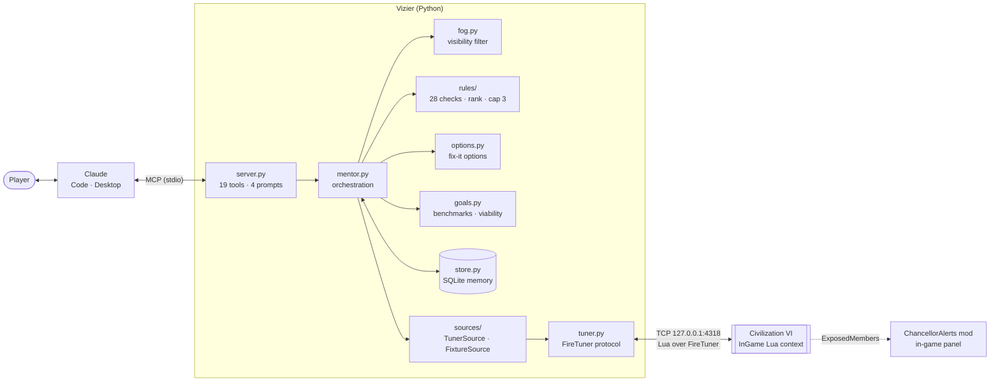
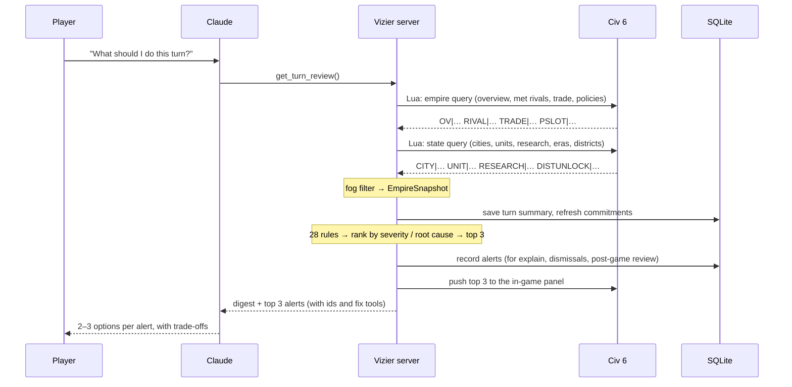

# Vizier: a Civ 6 mentor that coaches people, not bots

**Vizier** is an [MCP](https://modelcontextprotocol.io) server that connects
Claude to a live game of *Sid Meier's Civilization VI* and turns it into a
coach for the human player. Each turn it reads the game, checks it against 28
rules drawn from benchmark research and pro players, and tells you the three
things that matter most. It shows exact numbers, sees only what you could see,
and never makes a move for you.

```text
Turn 23 · America · 2 cities · 160 gold (+9) · 0 faith · explored 14%
Era: Ancient Era · normal age · era score 11 (normal age at 11, golden at 25)
Researching: Writing 83% · eureka not yet: Meet another civilization.
Civic: Foreign Trade 94% · inspiration not yet: Discover a second continent.
Goal: science (advisor, minimum pace)
Cities:
  Washington (pop 3, capital): building Settler, 13 turn(s) · 7 production · amenities +0 · housing 6 for 3 pop
  Chicago (pop 1): building NOTHING · 4 production · amenities -1 · housing 3 for 1 pop
Units:
  Scout at (15,21) · no moves left
  Scout at (9,30) · 3 move(s) left
  Warrior at (9,33) · 2 move(s) left

Top 3 of 4 alerts:
! [warning] 1 city has nothing to build
! [warning] Foreign Trade is 94% done without its inspiration
! [warning] Writing is 83% done without its eureka
Also noted: Chicago is displeased
```
*Real output from a live game (America, Prince difficulty). Claude turns it
into advice: "Chicago is idle. Build a Monument to grow its borders toward the
Tea, and finish Writing, since its eureka is mostly spent anyway."*

| | |
|---|---|
| **19** MCP tools · **4** prompts · **4** Claude Code skills | **28** deterministic rules, ranked and capped at 3 per turn |
| **102** tests, including the real Lua run against a fake Civ 6 engine | **0** runtime dependencies besides the `mcp` SDK |
| Game rules **verified by reverse-engineering** the shipped game database | **Verified live** against a running game on macOS |

---

## Contents

- [Why Vizier exists](#why-vizier-exists)
- [What it does](#what-it-does)
- [Architecture](#architecture)
- [How it works](#how-it-works)
- [Where the knowledge comes from](#where-the-knowledge-comes-from)
- [Guardrails](#guardrails)
- [Engineering highlights](#engineering-highlights)
- [Quick start](#quick-start)
- [Project layout](#project-layout)
- [Testing](#testing)
- [Limitations and roadmap](#limitations-and-roadmap)
- [References and credits](#references-and-credits)

---

## Why Vizier exists

**CivBench** ([civ6-mcp](https://github.com/lmwilki/civ6-mcp)) gave LLM agents
full control of Civilization VI and studied how they lose. The main failure
wasn't bad strategy. It was **not looking**:

- In **8 of 20 losses**, the agent never checked the rival victory threat that
  was plainly visible. In one game, Russia converted all 21 cities over 112
  turns and the agent never noticed.
- Agents carried out only **48–66% of their own plans**.
- The playbook already held the right advice. The agents just didn't apply it
  every turn, so the CivBench authors moved to hard triggers instead of soft
  advice.

Human players make the same mistakes: they miss the hidden threat, guess at
numbers the UI won't show, and drown in late-game busywork. Vizier applies the
CivBench lesson to people. **Code checks everything every turn; the LLM
explains what matters and why.** It's a coach, not an autopilot. CivBench
agents won 3 of 23 games at $31–229 per game, so full autoplay isn't the
product.

The product spec is *Civ 6 Mentor MCP: High-Value Asks & Features* (Hung
Duong, Nov 2026). This repository implements its MVP and v2 quick wins.

---

## What it does

| Area | What you ask | Tools |
|---|---|---|
| **Turn watcher** | "What should I do this turn?" | `get_turn_review`, `explain_alert`, `dismiss_alert` |
| **Fix-it options** | "Fix the unhappiness in Chicago, fastest" | `get_amenity_options`, `get_loyalty_options`, `get_housing_options` |
| **Map** | "Where should my next city go?" · "Show my luxuries" · "Tack the Campus spot" | `rank_settle_spots`, `get_tile`, `get_tiles`, `highlight_tiles`, `clear_highlights`, `find_park_sites` |
| **Planning** | "Am I on track for science?" · "Remind me: 3 cities by turn 50" | `set_goal`, `get_goal_status`, `add_commitment`, `list_commitments`, `update_commitment` |
| **Rivals** | "Is anyone about to win?" | `get_rivals` |
| **Coaching** | "Why did I lose?" | `get_game_review`; prompts `turn-check`, `plan-victory`, `war-check`, `post-game-review` |

**The 28 turn-watcher rules**, grouped:

- **Threats:** a rival close to a science, religious, diplomatic or culture
  win, with turns-to-win at its current pace; civilians next to visible
  enemies; barbarian camps; military imbalance.
- **Cities:** loyalty about to flip, unhappiness, housing caps, idle
  production, settling when no city has spare amenities.
- **Economy and tempo:** idle gold and faith, unused trade routes, eurekas
  about to be wasted, districts not placed to lock in their cost, Serfdom not
  slotted, God King left in, unused governor titles, spare luxuries to sell,
  cities one amenity away from a yield bonus.
- **Benchmarks:** exploration and city count against CivBench pace (or an
  optional pro pace), late districts, era score (dark-age risk, a golden age
  within reach).
- **Planning:** overdue commitments, and whether your victory path is still
  winnable, with suggested alternatives.
- **Data sanity:** values that look wrong (favor stuck at 0, ghost trade
  routes) are flagged, and the rules that depend on them go quiet.

**Example: fix-it options** (`get_loyalty_options`, recorded game):

```text
Nagoya — loyalty 40/100, -5.0/turn (~8 turns to zero). Breakdown: Citizen pressure from Korea -9.0, Your citizens +6.0
1. Buy Monument: +1 loyalty/turn, now, costs 240 gold
2. Assign a governor here: +8 loyalty/turn, 5 turn(s), costs an unassigned governor [estimate]
3. Build Monument: +1 loyalty/turn, 10 turn(s), costs 60 production
4. Raise amenities to Content (3 more): +6 loyalty/turn, depends
Fastest combination: Buy Monument + Assign a governor here → +9 loyalty/turn within 5 turn(s).
```

**Example: settle ranking** (`rank_settle_spots`, live game). It also drops
map tacks with the settler icon in-game:

```text
1. (10,24) score 87 · 5 tiles away · the game's advisor recommends this too
   coast; luxury: Tea (1 new type); Campus adjacency nearby ~+2 (1 mountain)
2. (10,20) score 84 · 7 tiles away · the game's advisor recommends this too
   no fresh water; luxury: Diamonds, Tea (2 new type)
```

---

## Architecture

### System overview



### One turn review, end to end



### Layers

| Layer | Files | Responsibility |
|---|---|---|
| **Interface** | `server.py`, `cli.py`, `.claude/skills/` | MCP tools and prompts; the same tools from the shell; Claude Code skills |
| **Mentor** | `mentor.py` | Ties source → fog → store → rules together. MCP-free, so tests and replays use it directly |
| **Knowledge** | `rules/`, `options.py`, `goals.py`, `benchmarks.py`, `gamedata.py` | Deterministic checks, fix-it pricing, benchmarks, verified game constants |
| **Safety** | `fog.py` | The single visibility filter between game data and every tool |
| **Memory** | `store.py` | Goals, commitments, alert history, dismissals, turn summaries, remembered camps |
| **Game access** | `sources/`, `tuner.py` | `StateSource` interface; live tuner source plus a JSON fixture source; FireTuner client |
| **In-game UI** | `mod/ChancellorAlerts/` | Optional Civ 6 mod that shows the top 3 alerts without alt-tabbing |

---

## How it works

### 1. Talking to the game
With `EnableTuner 1` in `AppOptions.txt`, Civ 6 opens a debug port on
localhost (the FireTuner protocol: length-prefixed frames, a handshake that
lists the game's Lua states, then `CMD:<state>:<lua>`). `tuner.py` speaks that
protocol. Vizier sends small Lua scripts to the game's **InGame** context, the
same context the game's own UI runs in, and parses the pipe-delimited lines
they print. A full turn review takes **two round trips**.

Every engine API Vizier calls was found in the game's own shipped UI code. For
example, amenities come from `GetAmenities() − GetAmenitiesNeeded()`, the same
formula the city panel uses (`CitySupport.lua:526`).

### 2. Fog of war, enforced twice
FireTuner can read the whole map, so a mentor could easily "cheat". Vizier
filters at two layers:

1. **At the source:** the Lua only emits revealed plots and met civs, and only
   resources your techs reveal (`IsResourceVisible`).
2. **In Python:** `fog.py` strips anything tagged hidden. For revealed tiles
   you can't currently see, it keeps only terrain and resources (improvements
   and owners may have changed since you looked).

Tests plant hidden markers (an unmet civ, a hidden resource) in raw data and
fail if any tool output contains them. The same check runs on the real Lua
inside a fake engine. A debug full-vision mode exists for development, is off
by default, and stamps every output with a warning.

### 3. The rule engine
Each rule is a plain function from an `EmpireSnapshot` to alerts. The engine
then:

- runs **sanity rules first**, which mark suspect data so other rules skip it;
- sorts by **severity**, then **root cause** early in the game (exploration,
  then expansion, then the rest, following CivBench's failure chain), then by
  category later;
- applies the **help level** (off · watchdog · advisor · coach), snoozes, and
  **retires** rules you keep dismissing (never critical ones);
- keeps **3**.

### 4. Numbers you can trust
- **Live values** (costs, turns, yields, loyalty breakdowns) come straight from
  the running game.
- **Rule tables** (amenities per building, housing, how many cities a luxury
  feeds) are read from the game's own rule data once per game. Reverse
  engineering showed these differ between rule sets (the Palace gives 1 or 2
  amenities), so nothing is hard-coded when a live game is available.
- **Engine-native checks** are reused rather than reimplemented: National Park
  sites come from `GetPossibleParkTiles`, settle legality from
  `IsValidFoundLocation`, and the game's own settler advisor is flagged in
  rankings.

### 5. Memory
A small SQLite database (`~/.chancellor/chancellor.sqlite3`), keyed by civ and
map seed so games never mix, stores turn summaries (for trends and
turns-to-win), alert history (for `explain_alert` and the post-game review),
commitments, goals and barbarian camps seen earlier (fog memory).

---

## Where the knowledge comes from

Every rule traces back to a source.

### CivBench paper and devlogs (civ6-mcp)
*CivBench: A Civilization VI benchmark for LLM agents* (2026), with the
cross-game analysis of games 1–4 in civ6-mcp's `docs/cross-game-analysis.md`.

| CivBench finding | Vizier feature |
|---|---|
| Rival victory missed (4 of 4 games) | `rival_victory` with turns-to-win; `get_rivals` |
| Exploration neglect: 9% explored at T40 | `exploration` benchmark plus a "no scout" alert |
| Slow expansion: city 2 at T59–62 vs a T30–40 benchmark | `expansion` benchmarks (city 2 by T30–40, 3 by T50–75, 4 by T80–100) |
| Plans not carried out (48–66% follow-through) | `add_commitment` with auto-checks and overdue alerts |
| Builders and settlers captured | `civilian_at_risk` |
| Barbarian camps left to escalate | `barbarian_camp` with fog memory |
| Stuck on an unwinnable victory path | `goal_viability` pivot rules (e.g. under 4 cities at T100 rules out science) |
| 3,936 gold idle; faith hoarded | `idle_gold`, `idle_faith` |
| Trade routes idle for 60 turns | `trade_slot` |
| Favor display stuck at 0 for 200+ turns | `data_favor` sanity rule |

### Ursa Ryan: *Civ 6 | EVERY DECISION EXPLAINED, The Ultimate Deity Science Playthrough*
YouTube, Aug 14, 2025 ([search](https://www.youtube.com/results?search_query=Ursa+Ryan+Civ+6+Every+Decision+Explained+Deity+Science)).
A full Deity science game with every click explained.

| Lesson | Vizier feature |
|---|---|
| Plan around era score; ten-turn countdown | `era_score` rule; era line in every review |
| Amenities only pay at net +3 (+10%) and +5 (+20%) | `amenity_threshold`; threshold notes in amenity options |
| Sell spare luxuries; gold beats production when going wide | `luxury_surplus` |
| Expand in phases: 4 cities mid-Classical, 7 by Medieval, 12+ after | optional **pro pace** benchmark |
| Pause settling until the luxuries are there | `settle_amenities` |

### Herson: *Civ 6 Overexplained: How to play the early game like a Pro*
YouTube, Apr 25, 2026 ([search](https://www.youtube.com/results?search_query=Herson+Civ+6+Overexplained+early+game+like+a+Pro)).
The multiplayer early-game meta, with every decision explained.

| Lesson | Vizier feature |
|---|---|
| Never finish a tech or civic before its boost | `eureka_guard` |
| District cost rises with tech/civic progress until you place one | `district_lock_in` (pushes the Government Plaza early) |
| Serfdom is "game-definingly strong"; swap God King after the pantheon | `policy_swaps` |
| Spread governor titles (Audience Chamber +3 food/+3 housing) | `governor_titles` |
| Don't float gold early | lower early threshold in `idle_gold` |

### Player complaints (via the spec)
The spec draws on Suede's *6 issues I had with Civ 6* (YouTube, Aug 2024) and
its comments: hidden numbers, visual clutter, national parks that are nearly
impossible to plan. Hence the tile queries and map tacks (`get_tiles`,
`highlight_tiles`) and `find_park_sites`.

### The game itself, verified with REA
Rule constants (happiness thresholds, loyalty levels, victory thresholds,
amenity and housing values, policy amounts, adjacency bonuses, luxury reach)
were read from Civ 6's compiled gameplay database with
[REA](https://github.com/morluto/rea), a reverse-engineering toolkit. Each is
cited by evidence ID in `src/chancellor/gamedata.py` and
[`docs/game-data-evidence.md`](docs/game-data-evidence.md). This process also
found a bug in civ6-mcp (amenities reported as needed + have) and the rule-set
differences that led to live rule tables.

---

## Guardrails

| Principle | How it's enforced |
|---|---|
| **Never sees past the fog** | Two-layer filter plus leak tests |
| **Never plays for you** | No tool changes game state. Highlights are display-only; map tacks need an explicit request and can be removed in one call |
| **Doesn't nag** | At most 3 alerts per turn; snooze; rules you keep dismissing retire; four help levels |
| **Options, not orders** | Server instructions and prompts ask for 2–3 options with trade-offs |
| **Respects your goal** | Advice follows your declared victory and style, even a roleplay game |
| **Stays local** | The tuner client refuses any non-localhost host |
| **Single player** | Designed for single player; never for live advice in multiplayer |

---

## Engineering highlights

- **Grounded in evidence, not memory.** Game rules come from reverse-engineering
  the shipped database (with evidence IDs), engine APIs from the game's own UI
  code, and benchmarks from published research. Where a number couldn't be
  verified (the governor's +8 loyalty), the output labels it an estimate.
- **Correct by construction for fog of war.** One choke point, filtering at
  both the source and in Python, and tests that try to leak planted hidden data
  through every tool.
- **A protocol client from scratch.** Vizier speaks the FireTuner wire protocol
  directly, with reconnection, sentinel-terminated responses and a single-flight
  lock. It started as a civ6-mcp dependency and was made standalone (MIT credit
  in `NOTICE`).
- **Tested without the game.** The real Lua queries run inside an embedded Lua
  runtime against a fake Civ 6 API (`tests/fake_civ6.lua`). The protocol client
  is tested against a fake server speaking the real wire format. The MCP tools
  are driven over the actual protocol in-process, with every output scanned for
  leaks.
- **Verified live.** Each feature was run against a real game. When the first
  map highlight drew nothing on screen, the fix was found in the game's own
  `WorldInput.lua`. When reverse engineering showed rule tables differ by rule
  set, the tables moved to live reads.
- **Clean seams.** `StateSource` separates where data comes from (live tuner,
  recorded fixture, and later replays or saves) from what Vizier does with it.
  `Mentor` is MCP-free.

---

## Quick start

**You need:** Civilization VI (tested on macOS with Gathering Storm), Python
3.12+, and Claude Code or Claude Desktop.

```bash
git clone git@github.com:lukasd181/the-chancellor.git
cd the-chancellor
python3.12 -m venv .venv
.venv/bin/pip install -e .
```

**1. Turn on the tuner.** In
`~/Library/Application Support/Sid Meier's Civilization VI/Firaxis Games/Sid Meier's Civilization VI/AppOptions.txt`
set `EnableTuner 1`, then start Civ 6 and load a single-player game.
Achievements are disabled while the tuner is on.

**2. Connect a client.**

- **Claude Code:** open the repo folder. `.mcp.json` registers the
  `chancellor` server; approve it, then use `/turn-check`, `/plan-victory`,
  `/war-check`, `/post-game-review`, or just ask.
- **Claude Desktop:** add this to
  `~/Library/Application Support/Claude/claude_desktop_config.json` and
  restart the app (Cmd+Q). The prompts appear under **+** → **chancellor**.

  ```json
  "mcpServers": {
    "chancellor": { "command": "/absolute/path/to/the-chancellor/.venv/bin/python", "args": ["-m", "chancellor"] }
  }
  ```
- **Shell:** `.venv/bin/python -m chancellor.cli get_turn_review`
  (`--list` for every tool).

**No game handy?** Try the recorded mid-game:

```bash
.venv/bin/python -m chancellor.cli --fixture tests/fixtures/midgame.json get_turn_review
```

**Optional in-game panel:** copy `mod/ChancellorAlerts` into
`~/Library/Application Support/Sid Meier's Civilization VI/Mods/` and enable
*Vizier Alerts* under Additional Content.

> The game accepts **one** tuner connection. Use Vizier from one app at a
> time, and close FireTuner or other tuner clients.

| Environment variable | Purpose |
|---|---|
| `CHANCELLOR_FIXTURE` | Serve a recorded JSON snapshot instead of a live game |
| `CHANCELLOR_DB` | SQLite location (default `~/.chancellor/chancellor.sqlite3`) |
| `CIV_MCP_PORT` | Tuner port (default 4318; the host is always localhost) |
| `CHANCELLOR_DEBUG_FULL_VISION` | Developer-only: disable fog filtering (every output is stamped) |

---

## Project layout

```text
src/chancellor/
├── server.py          MCP tools and prompts (FastMCP)
├── cli.py             call any tool from the shell
├── mentor.py          orchestration: source → fog → store → rules
├── fog.py             the visibility filter
├── rules/             28 rules: victory, empire, expansion, era, tempo,
│                      safety, diplomacy, planning, sanity
├── options.py         fix-it options (amenities, loyalty, housing)
├── goals.py           goal status, viability, commitments
├── benchmarks.py      CivBench and pro-pace milestones
├── gamedata.py        REA-verified rule constants (fallback for live tables)
├── narrate.py         text the LLM reads
├── store.py           SQLite memory
├── models.py          EmpireSnapshot, CityView, Alert, FixOption, …
├── tuner.py           FireTuner protocol client
└── sources/
    ├── base.py        StateSource / UIWriter interfaces
    ├── tuner.py       live game source
    ├── fixture.py     recorded JSON source (tests, demos, replays)
    └── lua_queries.py every Lua query Vizier sends to the game
mod/ChancellorAlerts/  optional in-game alert panel (Lua + XML)
.claude/skills/        turn-check, plan-victory, war-check, post-game-review
docs/game-data-evidence.md   REA evidence for every game constant
tests/                 102 tests (see below)
```

---

## Testing

```bash
.venv/bin/pip install pytest lupa
.venv/bin/python -m pytest
```

| Suite | What it proves |
|---|---|
| `test_rules.py` | Each rule's thresholds, ranking, the cap of 3, help levels, snooze and retirement |
| `test_fog.py` | Nothing hidden reaches any mentor output |
| `test_lua_queries.py` | The real Lua runs against a fake Civ 6 API, parses correctly and drops hidden data |
| `test_tuner.py` | The FireTuner client against a fake server speaking the real wire format |
| `test_server.py` | Every tool over the MCP protocol, with leak scanning and bad-input handling |
| `test_mentor.py`, `test_options.py` | End-to-end flows on a recorded mid-game: commitments, camps, fix-it options |

Only a live game proves the engine accepts every call. Each feature was also
run against a real game; the commit messages note what was verified live.

---

## Limitations and roadmap

**Known limits**
- Needs the FireTuner debug port, which disables achievements. A logs-and-saves
  source for players who keep achievements fits the `StateSource` interface but
  isn't built.
- Tested on macOS. Windows and Linux should work (same protocol) but are
  unverified.
- Some gains are labelled estimates where the game data doesn't carry them
  (e.g. the governor's base loyalty).
- Tile output doesn't report rivers yet.

**Next (from the spec's roadmap)**
- v2: `rank_district_sites` / `rank_district_pairs`, `compare_policies` (the
  "+8 vs +50 culture" complaint), `rank_production`, `rank_purchases`,
  `rank_trade_routes`.
- v3: `propose_batch` / `apply_batch`, game actions that run only after the
  player approves, plus skill tracking across games.
- Replay CivBench game logs through the rules to measure which alerts fire
  before losses and how often they misfire in wins.

---

## References and credits

- **CivBench / civ6-mcp:** *CivBench: A Civilization VI benchmark for LLM
  agents* (2026), from the civ6-mcp project by Liam Wilkinson. Code:
  [github.com/lmwilki/civ6-mcp](https://github.com/lmwilki/civ6-mcp)
  (MIT); site: [civbench.vercel.app](https://civbench.vercel.app). Vizier's
  FireTuner client and several queries are adapted from civ6-mcp; see `NOTICE`.
- **Ursa Ryan:** *Civ 6 | EVERY DECISION EXPLAINED, The Ultimate Deity Science
  Playthrough (Civilization VI #Guide)*, YouTube, Aug 14, 2025.
- **Herson:** *Civ 6 Overexplained: How to play the early game like a Pro*,
  YouTube, Apr 25, 2026.
- **Suede:** *6 issues I had with Civ 6*, YouTube, Aug 2024 (cited in the spec).
- **Spec:** Hung Duong, *Civ 6 Mentor MCP: High-Value Asks & Features*,
  Nov 22, 2026.
- **REA:** [github.com/morluto/rea](https://github.com/morluto/rea), used to
  verify game rules from the shipped database.
- **Model Context Protocol:** [modelcontextprotocol.io](https://modelcontextprotocol.io).

*Civilization VI is a trademark of Take-Two Interactive / Firaxis Games. Vizier
is an unofficial fan project and isn't affiliated with or endorsed by them.*
